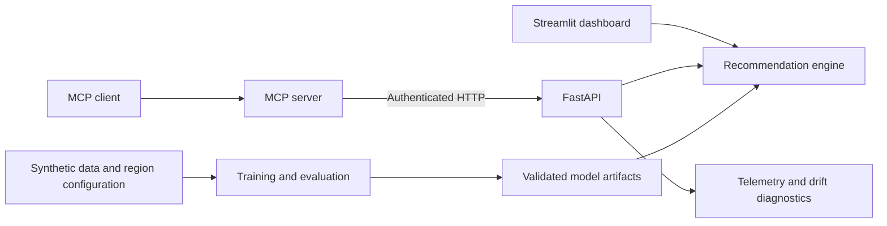

# HybridRecMCP

**A property-service recommendation platform built with machine learning, FastAPI, MCP, and Streamlit.**

HybridRecMCP brings customer context, service history, and regional factors into a single recommendation workflow. It ranks relevant services, provides a separate follow-up priority estimate when enough information is available, and exposes the same recommendation engine through an interactive dashboard, REST API, and Model Context Protocol (MCP) tools.

**[Live demo](https://hybridrecmcp-w4yxzprsd9m6bdlrxd6puy.streamlit.app/)** · **[Architecture](docs/architecture.md)** · **[API reference](docs/api_reference.md)** · **[Evaluation](docs/evaluation.md)**


## Highlights

- **Personalized recommendations:** Content-based profile matching and SVD collaborative filtering, with configurable hybrid ranking.
- **New-customer support:** Profile-based recommendations without requiring historical interactions.
- **Actionable presentation:** Service-specific context, simulated follow-up priorities, and suggested questions for staff.
- **Regional scenarios:** Configurable Tucson, Arizona, and Ohio demonstrations with service suitability rules.
- **Multiple integration paths:** Standalone Streamlit dashboard, authenticated FastAPI endpoints, and MCP tools.
- **Reproducible engineering workflow:** Deterministic synthetic data, isolated evaluation, model artifact validation, automated tests, and CI checks.

## Architecture



The Streamlit application loads the recommendation engine directly, so the demo does not need a running API or API credentials. MCP integrations use the separately configured, authenticated FastAPI service.

### Recommendation pipeline

| Component | Approach | Purpose |
| --- | --- | --- |
| Content-based filtering | Encoded customer/property features and cosine similarity | Identify services relevant to a property profile |
| Collaborative filtering | Truncated SVD over customer-service interactions | Model patterns in historical service preferences |
| Ranking | Validation-selected content/collaborative weights | Produce ordered service suggestions |
| New-customer recommendations | Profile-based relevance scoring | Handle profiles with no prior interactions |
| Follow-up priority | Gradient boosting on contextual features | Provide a separate illustrative priority estimate |
| Monitoring | Structured, privacy-conscious logs; PSI and KS diagnostics | Inspect changes in observed input distributions |

Recommendation relevance and follow-up priority are separate outputs. Service eligibility filters apply to both existing and new customers. For the shipped synthetic benchmark, validation selected a content-only weighting; the collaborative and hybrid implementations remain available for experimentation and comparison.

## Technology

| Area | Stack |
| --- | --- |
| Machine learning | Python 3.12, scikit-learn, pandas, NumPy, SciPy |
| Backend | FastAPI, Pydantic, Uvicorn |
| Agent integration | Model Context Protocol (official Python SDK) |
| Demo | Streamlit |
| Quality and delivery | pytest, Ruff, mypy, GitHub Actions, Docker |

Dependency sets are separated for the Streamlit demo, backend runtime, and development workflows.

## Quick start: Streamlit demo

Use Python 3.12 from the repository root.

```bash
python -m venv .venv
```

Activate the environment:

```powershell
# Windows PowerShell
.\.venv\Scripts\Activate.ps1
```

```bash
# Linux / macOS
source .venv/bin/activate
```

Install the demo dependencies and launch the application:

```bash
python -m pip install -r requirements.txt
python -m streamlit run demo.py
```

Open the local URL shown by Streamlit (normally `http://localhost:8501`). On first launch, the application prepares a version-checked model from the included synthetic data; subsequent reruns reuse the cached engine. No external API or manually supplied model file is required.

To start the demo with Ohio selected by default, set `DEMO_DEFAULT_REGION=ohio` in the process environment. The region remains selectable in the UI.

## Run the API and MCP server

Install backend dependencies:

```bash
python -m pip install -r requirements-api.txt
```

Create a local `.env` file based on `.env.example`, set a strong `API_KEY`, and train the backend artifact:

```bash
python train.py
python -m uvicorn main:app --host 127.0.0.1 --port 8000
```

API documentation is available at `http://127.0.0.1:8000/docs`. Protected endpoints require the `X-API-Key` header.

| Endpoint | Description |
| --- | --- |
| `POST /recommend` | Recommend services for an existing customer |
| `POST /recommend/new-customer` | Recommend services from a new property profile |
| `GET /services` | Retrieve the service catalog |
| `GET /health` | Check API and model readiness |

For MCP integration, configure your MCP client to launch `server.py` using the same API base URL and key. The server exposes `recommend_for_customer`, `recommend_for_new_customer`, and `list_services`.

See the [API reference](docs/api_reference.md) and [MCP setup guide](docs/mcp.md) for request schemas and client configuration.

## Dataset and evaluation

The repository includes a reproducible, **synthetic** demonstration dataset: **500 property profiles, 3,000 service interactions, and 10 illustrative services**, spanning Tucson and Ohio scenarios. Prices, regional assumptions, service interactions, and priority labels are simulated rather than real customer records.

Evaluation separates held-out customers from warm-customer temporal splits, selects model configuration using validation data, and compares ranking methods against baseline strategies. Reported metrics include Precision@K, Recall@K, NDCG@K, HitRate@K, and catalog coverage, with separate urgency-model evaluation.

The benchmark describes model behavior on simulated data; it is not evidence of real-world treatment needs or commercial performance. Detailed metrics, assumptions, and comparisons are available in the [evaluation methodology](docs/evaluation.md), [results](reports/evaluation.json), and [data card](data/data_card.md).

## Testing and CI

Install development dependencies, then run the checks:

```bash
python -m pip install -r requirements-dev.txt
python -m pytest -q
python -m ruff check .
python -m ruff format --check .
python -m mypy
python scripts/check_streamlit_readiness.py
```

The GitHub Actions pipeline covers unit and integration tests, reproducible datasets and evaluation, MCP protocol interactions, clean Streamlit initialization, and Docker build/health checks. The verified feature-branch and PR runs each passed **124 tests**, including separate Streamlit readiness and container jobs.

## Deployment

- **Streamlit Community Cloud:** Hosts the standalone interactive demo. See [deployment instructions](docs/streamlit_deployment.md).
- **Docker / FastAPI:** Provides a containerized backend for API and MCP integrations. See [deployment documentation](docs/deployment.md).


## Author

**Nada Bastawi**  
[GitHub](https://github.com/NadaBastawi)

## License

Licensed under the [MIT License](LICENSE).
