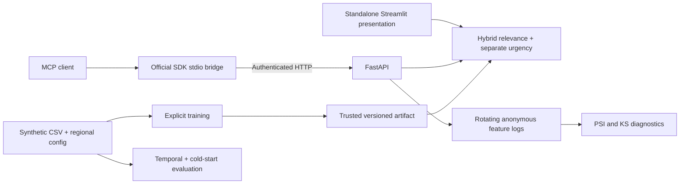

# HybridRecMCP

**Independent AI/ML proof of concept for property-service recommendations.** Developed by Nada Bastawi. Unofficial, synthetic-data project inspired by a pest-control business use case. No company commission, endorsement, partnership, customer integration, or authorization is claimed.

## 1. Project overview

HybridRecMCP suggests services staff might discuss with a property owner, using profile similarity and service history. It includes an authenticated REST API, an official-SDK MCP bridge, privacy-conscious telemetry, and a standalone Streamlit business demonstration.

## Live demonstration

**Public deployment pending.** No hosted URL has been published or verified. The code
is prepared for Streamlit Community Cloud; visitors will need only a browser once it
is published. See [exact deployment steps](docs/streamlit_deployment.md) and the
[public presentation checklist](docs/public_demo_checklist.md). Azure hosts the
optional FastAPI backend separately and is not required by the dashboard.

## 2. Business problem

Staff may need to compare property characteristics, previous service visits, and possible preventive follow-ups. This prototype explores whether recommendations could make that review more consistent. It does not establish how any particular company currently operates.

## 3. Proposed solution

Enter a property profile or select an existing synthetic customer. Review ranked service ideas and a separate simulated priority estimate, then have a staff member confirm conditions and decide whether an inspection is appropriate. No booking or treatment is performed.

## 4. Architecture



The Streamlit presentation runs the engine directly, with a private model cache prepared from committed synthetic data when needed. It requires no API server or API credentials. MCP uses the separate authenticated API.

## 5. Features

- Existing-customer hybrid ranking and profile-based cold start.
- Separate relevance scores and illustrative priority estimates.
- Explicit residential/commercial suitability; Ohio excludes the scorpion demo service.
- Independent Tucson and Ohio scenarios; `DEMO_DEFAULT_REGION=ohio` can change the UI default.
- Service-specific rule context and staff questions; unknown history leaves priority unknown.
- Authenticated catalog and recommendation endpoints, validated inputs and stable schemas.
- Deterministic synthetic generation and leakage-free evaluation with baselines.
- Functional MCP tools, real stdio client tests, health and telemetry diagnostics.

## 6. Technology stack

Python 3.12, scikit-learn, pandas, NumPy, SciPy, FastAPI, Pydantic, Uvicorn, official `mcp` SDK 1.x, Streamlit, pytest, Ruff, mypy and Docker. Runtime, presentation, and development dependencies have separate universal lock files. MCP 1.x is deliberately pinned to retain the tested ClientSession/FastMCP interface; see the [official maintenance-line documentation](https://github.com/modelcontextprotocol/python-sdk/tree/v1.x).

## 7. Dataset and limitations

The shipped dataset contains **500 synthetic profiles, 3,000 simulated completed visits, and 10 illustrative services**, in a fixed 2023–2025 window. The combined dataset has 375 Tucson and 125 Ohio profiles. Names and email addresses are not generated. All prices, ZIP groupings, service weights, ratings and priorities are assumptions.

Tucson remains the default scenario. Ohio is a separate illustration; similarly named businesses must not be assumed to share ownership or legal identity. No identity, ownership, service territory or pricing information for a real company is asserted here. See [data card](data/data_card.md) and [regional assumptions and sources](docs/regional_assumptions.md).

## 8. Recommendation methodology

- **Content:** one-hot property/region features, scaled building age and configured flags; cosine similarity to service centroids derived only from training profiles and highly rated training visits. Unknown internal categories are handled; public inputs use an explicit supported category set.
- **Collaborative:** low-rank SVD with iterative missing-rating completion. Repeated ratings are averaged. Missing cells start from smoothed item means and are never labeled explicit negative preferences. This small-data heuristic is compared with simpler alternatives.
- **Hybrid:** bounded cosine and rating/5 scores, deterministic service-ID tie breaking. Weight and SVD rank are selected using validation NDCG only. Scores express ranking signals, not booking probabilities or calibrated confidence.
- **Cold start:** the content model uses the new property's profile; urgency does not determine relevance ranking.
- **Priority:** gradient boosting learns a deliberately noisy synthetic rule. Predictions are bounded 1–10 and are not validated infestation risks, service deadlines or substitutes for professional assessment.
- **Repeat policy:** repeat services remain eligible because preventive and recurring visits can be useful. A previous inspection never implies treatment is required. Suitability flags and region apply to all methods.

## 9. Verified evaluation results

See [evaluation report](reports/evaluation.json) and [evaluation methodology/results](docs/evaluation.md). These files contain measured local results; no real-world accuracy or business lift is claimed. The previous 96.2% Precision@5 claim was withdrawn because the original evaluation leaked held-out interactions and calculated hit rate under the wrong name.

Twenty percent of customers are reserved before any model or preprocessing fit. The remaining customers' events are split globally by date into approximately 60% training, 20% validation and 20% test time. Models and weights are fitted/selected before the test period. Relevant items are distinct future completed bookings, not expert labels. No held-out profile fits a transform or service centroid. The deployment artifact is subsequently trained on all synthetic records; it is distinct from the evaluation model.

Measured warm-test results (298 synthetic customers, 452 future bookings):

| Method | Precision@5 | NDCG@5 | Coverage |
|---|---:|---:|---:|
| Validation-selected, content only | 0.2007 | 0.4704 | 100% |
| Fixed 40/60 hybrid | 0.1832 | 0.4447 | 100% |
| Popularity baseline | 0.2054 | 0.4921 | 50% |
| Illustrative profile-rule baseline | 0.2242 | 0.5521 | 90% |

Validation selected a **zero collaborative weight** for this dataset. Popularity remains competitive; no hybrid-superiority claim is made. Cold-start content Precision@5 is 0.2000 (67 customers). Urgency MAE/RMSE are 0.7508/0.8699; the generator-aware rule baseline performs better (0.6814/0.8255). These measurements support engineering review, not real-world effectiveness claims.

## 10. Installation

Run from the repository root. Windows PowerShell:

```powershell
python -m venv .venv
.\.venv\Scripts\Activate.ps1
python -m pip install -r requirements-dev.txt
```

On Linux/macOS use `source .venv/bin/activate`. API/MCP only: `requirements-api.txt`;
presentation: root `requirements.txt` or `requirements-demo.txt`; testing/notebook
tooling: `requirements-dev.txt`. Root requirements deliberately selects the demo lock
because Community Cloud discovers that filename for root `demo.py`.

For the backend API/MCP only, generate a secret locally, then copy `.env.example` to `.env` and set `API_KEY` to that value. The standalone dashboard needs no key. Never commit it:

```powershell
python -c "import secrets; print(secrets.token_urlsafe(32))"
Copy-Item .env.example .env
```

## 11. Running locally

```powershell
python generate_data.py
python evaluate.py
python train.py
python -m uvicorn main:app --host 127.0.0.1 --port 8000
```

The shipped CSVs and evaluation report are already present: regeneration/evaluation
is optional for reproducibility work, not dashboard startup. `generate_data.py --region
tucson` or `--region ohio` creates a single-region dataset; rerun evaluation and training
after changing data/config. Tests of shipped mixed-region data expect the default combined generator.

API startup **loads** a trusted artifact and checks data/config/code/dependency fingerprints. It never silently trains. Missing/stale artifacts or missing/placeholder keys fail startup with an actionable error. Retrain after changing model code, Python, data, regional configuration, or ML dependencies. Health: `http://127.0.0.1:8000/health`.

## 12. Backend API

Install `requirements-api.txt`, configure API_KEY and run `python train.py` before
starting Uvicorn. API authentication remains mandatory, including unknown-history requests.

Interactive contracts: `http://127.0.0.1:8000/docs`. Recommendation, services and monitoring routes require `X-API-Key`. Health and overview are public.

PowerShell (set the variable to the value in your local `.env`, without storing it in source):

```powershell
$headers = @{ 'X-API-Key' = $env:API_KEY }
Invoke-RestMethod http://127.0.0.1:8000/recommend -Method Post -Headers $headers -ContentType 'application/json' -Body '{"customer_id":"C0001","season":"summer","days_since_last_service":400,"top_n":5}'
Invoke-RestMethod http://127.0.0.1:8000/recommend/new-customer -Method Post -Headers $headers -ContentType 'application/json' -Body '{"property_type":"residential_house","zip_code":"85743","building_age_years":30,"region":"tucson","season":"summer"}'
```

Uvicorn reads `.env` through the application; the shell does not automatically import `.env`. Set `$env:API_KEY` in the caller shell when using these commands. See [API reference](docs/api_reference.md).

## 13. MCP integration

Start the API, then have an MCP client launch `python server.py` with **absolute** interpreter/script paths, `API_BASE`, and the same `API_KEY`. Tools: `recommend_for_customer`, `recommend_for_new_customer`, `list_services`. Errors are MCP error results, not successful recommendations. See [tested configuration and agent example](docs/mcp.md).

## 14. Interactive demo

```powershell
python -m streamlit run demo.py --server.address 127.0.0.1 --server.port 8501 --browser.gatherUsageStats false
```

Open `http://127.0.0.1:8501` locally. The first run prepares the model automatically;
reruns reuse it, and warm restarts validate/reuse the private artifact. Missing or
incompatible caches rebuild from the shipped data and compatible evaluation selection.
No evaluation pipeline runs at startup. Try a new homeowner with Unknown history,
switch to Ohio, then select an existing synthetic customer. Changing inputs clears
previous results. All screens label simulated data and illustrative prices. Use the
[60–90 second flow](docs/public_demo_checklist.md), [extended script](docs/demo_script.md)
or [business proposal](docs/business_proposal.md). For Ohio-first local presentation,
set `$env:DEMO_DEFAULT_REGION = 'ohio'` in PowerShell before starting Streamlit.

## 15. Testing and CI

```powershell
python -m pytest --cov=. --cov-branch --cov-report=term-missing
python -m ruff check .
python -m ruff format --check .
python -m mypy
python -m pip check
python scripts/check_notebook.py
python scripts/check_streamlit_readiness.py
```

Tests include an actual SDK stdio subprocess connected to an authenticated local HTTP API, request validation, data chronology, preprocessing/fit isolation, known-answer metrics, monitoring edge cases and Streamlit interactions. Required functionality is not silently skipped. Mypy currently checks the shared schemas/settings modules; other modules remain incrementally typed.

CI is configured to run checks, compile Python, verify data/evaluation reproducibility,
train, exercise Streamlit in a clean source copy using only host-selected dependencies,
and build/health-check Docker. CI runs on pushes to `main` and
`feature/streamlit-cloud-ready`, and on pull requests targeting `main`. Consult the
current pull request checks for the actual remote result. Optional Codecov requires
`CODECOV_ENABLED=true` and a token; normal tests require no Azure secrets.

The [original validation report](docs/validation_report.md) preserves the 93-test
baseline. The [cloud-readiness follow-up](docs/cloud_readiness_report.md) records the
subsequent deployment changes and executed checks; neither establishes public hosting.

## 16. Security considerations

The API requires a non-placeholder key of at least 16 characters and uses constant-time comparison. Keep it on localhost unless protected with TLS, rate limiting and appropriate network access controls. `.env` and model/log artifacts are ignored. Shared-key auth is a demonstration mechanism, not multi-user authorization.

Sentry is opt-in via `SENTRY_DSN`; default PII and tracing are disabled, and request/user/breadcrumb data are scrubbed. Prediction telemetry excludes customer IDs, ZIPs, names, email and keys; logs rotate. Logs are descriptive data and should still be access-controlled. Pickle/joblib artifacts execute code: load only artifacts from trusted local builds.

## Optional Azure deployment

Docker instructions and exact external Azure OIDC settings are in
[deployment notes](docs/deployment.md). Azure deploys FastAPI through the manual
`azure-demo` environment workflow. An allowlisted archive selects API-only dependencies;
the startup script validates authentication configuration and trains on the target
runtime. Azure authentication remains dependent on external Entra/GitHub settings.
No cloud deployment or account change is claimed. Publishing a feature branch and
opening a pull request do not deploy the dashboard or the Azure backend.

## 17. Future improvements

1. Validate suitability and priority rules with qualified domain experts; obtain consented representative data and explicit data governance.
2. Evaluate across multiple dates/seeds with uncertainty intervals, stronger baselines and carefully defined staff-feedback outcomes.
3. Pilot under human review with access controls, operational monitoring, and measured acceptance/inspection outcomes before assessing financial impact.

## 18. Author and project disclaimer

Nada Bastawi (`NadaBastawi` on GitHub) is the project developer, as supported by repository commit history. The original model card credited GitHub Copilot assistance; this refactor and documentation were assisted by OpenAI Codex. AI assistance is acknowledged without claiming authorship of every prior contribution.

This is an independent, unofficial portfolio proof of concept inspired by a pest-control business use case, not an authorized TORCO product. Company logos, testimonials, customer records, private systems, verified company prices and proven financial returns are not used. MIT license; see [LICENSE](LICENSE).
