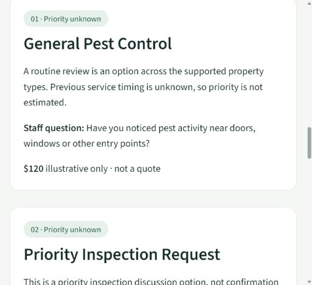

# Cloud-readiness follow-up — October 21, 2026

This is the pre-publication validation snapshot. Local machine identifiers were
sanitized for publication; see the pull request for the current Git/CI status.

The original [93-test validation report](validation_report.md) remains unchanged and
records the earlier work. This phase preserved the existing uncommitted implementation;
it did not reset/revert anything, regenerate shipped CSVs or change the ML methodology.
Ten baseline data/methodology/report files were checked against their saved SHA256 values.
The earlier implementation remains uncommitted, as do these changes.

## A. Issues found and addressed

- A committed localhost-only Streamlit binding prevented portable hosting; removed.
- Root requirements selected API-only dependencies; it now selects the existing demo
  lock. API/Docker/Azure explicitly retain the separate backend dependency set.
- Ignored local models were absent from fresh checkouts; a private, locked, validated
  first-run cache now reuses the existing deterministic training selection.
- Repeated explanations, invented new-customer intervals and stale displayed results
  were corrected, preserving the green/white layout, typography and relevance order.
- Legacy Streamlit error redaction still exposed stack traces. Strict `none` is set
  before application imports and tested; expected failures have friendly messages.
- Broad Azure zip packaging risked mixing demo dependencies and local files; an
  explicit backend allowlist now provides Oryx with API-only requirements.
- Azure authentication is an external configuration blocker, not a proven code fault.

## B. Exact incremental changes and Git status

These are changes **since the preserved local baseline**, rather than the much larger
diff against the old GitHub commit. 23 existing files changed and 17 files
were added during this phase. All dependency lock versions remain unchanged.

| File | This phase | Purpose |
|---|---|---|
| `.dockerignore` | Modified | Exclude Streamlit secrets from build context. |
| `.github/workflows/ci.yml` | Modified | Add compilation, shell syntax check and independent clean Streamlit readiness job. |
| `.github/workflows/main_hybridrecmcp.yml` | Modified | Retain manual OIDC deployment; allowlisted API package and post-deploy health/auth checks. |
| `.gitignore` | Modified | Ignore local Streamlit secrets. |
| `.streamlit/config.toml` | Modified | Remove localhost binding; retain green/light theme; strict error redaction. |
| `Dockerfile` | Modified | Install the API dependency entry point rather than the root demo set. |
| `README.md` | Modified | Separate live-demo pending status, local development, backend, MCP and optional Azure; retain verified metrics. |
| `demo.py` | Modified | Cached first-run initialization, safe errors, unknown history, stale-result clearing, region default and footer; existing layout retained. |
| `docs/api_reference.md` | Modified | Document nullable history/priority, staff question and retained numeric defaults. |
| `docs/architecture.md` | Modified | Document private demo cache lifecycle, trust boundary and nullable priority. |
| `docs/cloud_readiness_report.md` | Added | This phase's evidence, exact change inventory, statuses and handoff. |
| `docs/demo_script.md` | Modified | Rehearse unknown timing honestly and link short public presentation flow. |
| `docs/deployment.md` | Modified | Independent Streamlit/API deployment and precise external Azure OIDC/App Service checklist. |
| `docs/mcp.md` | Modified | Use API dependency entry point and document unknown-history tool behavior. |
| `docs/public_demo_checklist.md` | Added | Hosted-verification checklist and a 60–90 second business demonstration flow. |
| `docs/streamlit_deployment.md` | Added | Exact publishing/settings/dependency/startup/troubleshooting instructions and hosting limitations. |
| `explanations.py` | Added | Service-specific documented scenario context and staff questions. |
| `model_store.py` | Added | Private validated cache, atomic writes, thread/process locking and safe deterministic rebuild. |
| `monitoring/logger.py` | Modified | Record null priority safely for authenticated API requests. |
| `recommender.py` | Modified | Return unknown priority for unknown timing; add rule-grounded explanations without changing ranking/fitting. |
| `reports/cloud-demo-card.png` | Added | Actual local browser preview of Ohio service context, staff question and unknown priority. |
| `reports/cloud-git-status.txt` | Added | Complete final modified/untracked inventory, including preserved prior work. |
| `reports/cloud-readiness.json` | Added | Machine-readable incremental change manifest and verified/pending statuses. |
| `reports/cloud-tests.xml` | Added | Actual 124-test JUnit results; previous 93-test report preserved. |
| `reports/streamlit_readiness.json` | Added | Measured clean demo-only environment startup/restart and memory evidence. |
| `requirements-api.txt` | Added | Preserve API-only lock selection for backend/Docker installation. |
| `requirements.txt` | Modified | Select pinned demo dependencies under the filename Community Cloud automatically discovers. |
| `schemas.py` | Modified | Allow explicit null new-customer timing and additive follow-up question/UNKNOWN response fields. |
| `scripts/azure_start.sh` | Modified | Resolve project directory, validate API key, honor data/model/port settings and train on target runtime. |
| `scripts/check_backend_health.py` | Added | After an authorized deployment, check readiness and unauthenticated-route rejection. |
| `scripts/check_streamlit_readiness.py` | Added | Real clean-copy AppTest cold/warm/invalid restarts, both regions, inputs, time and peak memory. |
| `scripts/package_backend.py` | Added | Package an explicit source/data allowlist with API requirements aliased for Oryx. |
| `server.py` | Modified | Forward nullable new-customer timing through authenticated MCP. |
| `tests/test_api.py` | Modified | Explicit unknown timing and legacy-default compatibility; existing auth regressions retained. |
| `tests/test_demo.py` | Modified | Unknown/known timing, stale input changes, regions, safe errors, footer and traceback redaction regressions. |
| `tests/test_deployment.py` | Added | Verify host-selected dependencies and exact backend archive boundary. |
| `tests/test_explanations.py` | Added | Check prompts against implemented scenario rules; unknown timing never invokes urgency or changes relevance. |
| `tests/test_mcp.py` | Modified | Exercise unknown timing through actual MCP stdio and authenticated HTTP. |
| `tests/test_model_store.py` | Added | Missing/stale/corrupt/untrusted cache, compatibility, warm reuse and concurrent initialization regressions. |
| `train.py` | Modified | Expose existing full-data training; validate/reuse evaluation selection; fingerprint report and explanation code. |

Current checkout: branch `main`, HEAD `38e1cc43b78e4163d019fb278e105b9e22e4bfc6`.
Git reports **27 modified tracked files and 62 untracked files**, including
previous work. No files are staged. See [complete Git status](../reports/cloud-git-status.txt)
and [machine-readable evidence](../reports/cloud-readiness.json). Nothing was committed,
pushed, reset, reverted, deployed or published. `.env`, secrets, model/cache files and
logs are ignored and excluded from the source delivery.

## C. Streamlit status

| Stage | Result |
|---|---|
| Code prepared | Yes |
| Locally tested, including clean demo-only installation | Yes |
| Published to Streamlit Community Cloud | No |
| Public URL and hosted recommendation interaction verified | No |

The app requires neither API_KEY nor a separately running FastAPI backend. Python
**3.12** is selected in hosting instructions; actual local version was **3.12.3**.
First-run training uses committed data and the fingerprint-compatible existing
evaluation report. It does not run evaluation or regenerate datasets. Warm disk
artifacts are checked before deserialization; an in-memory resource survives reruns.
Missing/corrupt/stale caches rebuild; incompatible data/evaluation fail safely.
Checksums assume trusted server-owned storage and do not authenticate arbitrary uploads.

## D. Azure status

Repository-level workflow/startup/package corrections are complete. Authentication
is **pending external verification**; no workflow was dispatched and no hosted FastAPI
URL was verified. The earlier run 31852813788 failed at Login to Azure after a
successful build; detailed logs were unavailable (404), so the exact cause remains
uncertain. This phase did not repeat that investigation or invent resource identifiers.

Your administrator must configure GitHub environment `azure-demo`, its three
AZURE_CLIENT_ID/AZURE_TENANT_ID/AZURE_SUBSCRIPTION_ID secrets, and AZURE_WEBAPP_NAME
variable for an existing Python 3.12 Linux App Service. Entra federation must use
`repo:NadaBastawi/HybridRecMCP:environment:azure-demo`, the GitHub OIDC issuer and
AzureADTokenExchange audience. Configure scoped deployment permissions, App Service
API_KEY, Oryx build setting, startup command and writable model/log directories.
See the [exact Azure checklist and retry steps](deployment.md#azure-blocker-and-investigation).
Only dispatch the manual workflow after explicit authorization. No resources or costs
were created by this task. Post-deploy health/auth checking is implemented but unexecuted.

## E. Executed verification

All commands ran from the repository root. Development checks used
`../../work/.venv/Scripts/python.exe`; a newly created `../../work/.venv-cloud` environment
installed only root requirements using hash-verified cached wheels (no network install
or Linux hosting execution is claimed).

| Check | Actual result |
|---|---|
| `python -m pytest -q --junitxml=reports/cloud-tests.xml` | **124 passed, 0 failed, 0 skipped**, 51.43 s |
| Final dashboard-only regression after the last display change | **15 passed**, 11.77 s |
| `python -m ruff check .` | Passed |
| `python -m ruff format --check .` | Passed, 51 Python files |
| `python -m mypy` | Passed, configured schemas/settings scope (2 files) |
| `python -m pip check` | Passed in development and fresh demo-only environments |
| `python -m pip install --no-index --find-links ../../work/wheels -r requirements.txt` | Passed in new Python 3.12.3 environment |
| `python -m compileall -q main.py server.py demo.py train.py model_store.py explanations.py domain.py scripts monitoring` | Passed |
| `python evaluate.py --output ../../work/evaluation-cloud-check.json` | Passed; parsed JSON exactly matches preserved evaluation; Windows output newline bytes differ |
| `python train.py` | Passed; rebuilt the trusted backend artifact with current fingerprint |
| `python scripts/check_streamlit_readiness.py` in demo-only environment | Cold, warm-process restart and corrupt-cache recovery all passed |
| Actual full-data backend artifact smoke | `/health` 200; unauthenticated `/services` 401; authenticated Ohio/unknown-history recommendation 200 with 5 services |
| Actual local `python -m streamlit run demo.py --server.address 127.0.0.1 --server.port 8501` | Started successfully after server restart; real browser completed Tucson and Ohio flows |
| Backend archive generation and allowlist regression | Passed; API dependency entry point selected; no secrets/models/cache included |
| `git diff --check` | Passed; only informational README newline-normalization warning |
| `docker version` | Client present; engine unavailable (missing docker_engine pipe); build/container health not run |
| Local `sh -n scripts/azure_start.sh` | Blocked by Git Bash signal-pipe creation, Windows error 5; Linux CI syntax check added, not yet run remotely |
| GitHub CI, Azure workflow and public Streamlit deployment | Not executed |

One focused initial run had 60 passes and one outdated test expecting null history
to be rejected; that contract test was corrected and all final tests passed. An
initial byte-only evaluation comparison detected CRLF versus LF; semantic JSON
comparison passed and the committed report was not rewritten. The old long-running
Streamlit process initially held stale imported modules; restarting it resolved that
development reload issue. The browser test also exposed the redaction issue fixed above.

Final clean **demo-only** environment measurements (Windows; not hosting guarantees):

| Process start | Initialization seconds | Cached rerun seconds | Peak process MiB |
|---|---:|---:|---:|
| cold | 7.011 | 0.030 | 193.98 |
| warm | 5.194 | 0.043 | 188.63 |
| invalid | 6.363 | 0.066 | 193.07 |

Artifacts were 404,603 bytes. Warm checks preserved artifact modification time, so
no retraining occurred. The cold copy had no `models/`, cache, `.env` or API settings.
Each probe generated recommendations, switched regions/scenarios, checked invalid ZIPs
and cleared stale results. Tests additionally cover all profile changes, default Ohio,
unknown timing, service rule context, concurrent initialization, invalid metadata and
fail-closed API authentication. Real MCP tests launch the SDK stdio subprocess and
authenticated local HTTP service; Windows uses the documented subprocess fallback.

## F. Exact local startup

Historical workspace command; replace the example checkout path for your machine:

```powershell
Set-Location 'C:/path/to/HybridRecMCP'
..\..\work\.venv\Scripts\python.exe -m streamlit run demo.py --server.address 127.0.0.1 --server.port 8501
```

Open **http://127.0.0.1:8501**. The server was left running locally. No backend or key
is needed. For a portable checkout, use Python 3.12, create/activate a venv, install
`requirements.txt`, then run the same Streamlit command with `python`.
To present Ohio first: `$env:DEMO_DEFAULT_REGION = 'ohio'` before starting Streamlit.

API/MCP remain independent: install `requirements-api.txt`, configure a strong private
API_KEY, run `python train.py`, then `python -m uvicorn main:app --host 127.0.0.1 --port 8000`.
For MCP, configure absolute interpreter/server paths, API_BASE and the same key as
documented in [MCP setup](mcp.md). API startup never silently trains.

## G. Remaining public publishing steps

1. Review/commit/push these local changes to `NadaBastawi/HybridRecMCP` with your authorization.
2. In Streamlit Community Cloud select that repository, updated `main`, root `demo.py`
   and Advanced settings Python **3.12**. Root requirements automatically selects the demo lock.
3. Optionally configure non-secret `DEMO_DEFAULT_REGION = "ohio"`; no credentials required.
4. Deploy, copy the **actual issued URL**, then open it in a private browser and complete
   a recommendation interaction and the [public checklist](public_demo_checklist.md).

See [precise settings and troubleshooting](streamlit_deployment.md). No public URL is
invented or claimed. Free hosting may sleep, cold-start slowly or lose local storage.

## H. Presentation readiness

Ready for a professional **local independent proof-of-concept demonstration** and for
reviewed publication. The green/white visual identity, width and two-column layout are
preserved. The local browser's narrow viewport rendered the stacked responsive layout
and service questions correctly; full desktop/mobile device rehearsal at the hosted
URL remains a manual checklist item. No new device-wide layout certification is claimed.

Use the [60–90 second business flow](public_demo_checklist.md), with ML/API/MCP details
discussed separately. A known-interval browser result kept a medium-priority service
above high-priority cards, confirming priority did not reorder relevance. New unknown
history shows Unknown rather than a fabricated date or a reassuring zero priority count.

All records are synthetic and prices illustrative. This is not production readiness,
company endorsement, verified business lift, infestation detection or validated treatment
advice. The selected content-only model still does not consistently beat simpler
baselines; all earlier evaluation metrics and limitations remain unchanged.

## I. Remaining blockers and user actions

- Review and authorize commit/push before remote hosts can see this implementation.
- Publish on Community Cloud and verify its actual public URL and interactions; no
  account settings or public exposure were changed by this task.
- Complete Entra/GitHub/App Service configuration before an explicitly authorized Azure run.
- Start a Docker engine if local image build/container verification is required.
- Run the revised Linux CI after an authorized push; local Windows tests do not verify
  the hosting OS, hosted package download availability or Azure startup execution.
- Domain review, consented real-world data and outcome evaluation remain future work,
  outside this independent synthetic portfolio demonstration.


