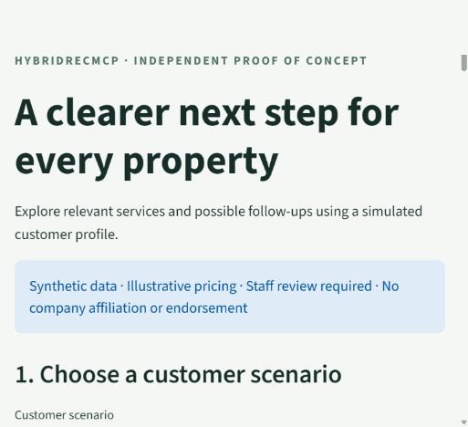
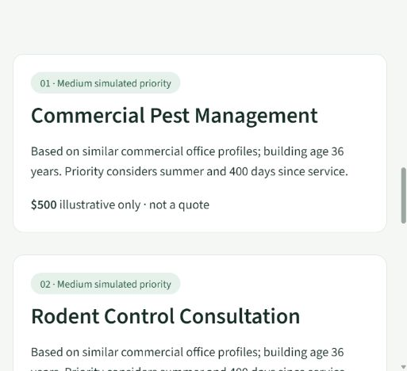

# HybridRecMCP — Technical implementation and validation report

**Verified locally on 21 October 2026.** Base commit: `38e1cc43b78e4163d019fb278e105b9e22e4bfc6`. Changes are in this local checkout only. No commit, push, workflow dispatch, cloud deployment or company contact was performed.

## 1. Audit findings

See [prioritized audit](audit.md). High-severity baseline defects included train/test leakage and misnamed metrics; broken MCP contracts/authentication; fail-open API authentication; missing Docker runtime imports; and invalid, unreproducible chronology. Original data contained 926 pre-membership interactions and 1,817 rows generated using history containing later dates. Medium-severity issues covered ordinal similarity encoding, urgency-only cold start, unvalidated inputs, disconnected/fabricated drift telemetry, hardcoded Sentry configuration and unsupported documentation. These repository defects were addressed. External Azure identity configuration remains outside the local source changes.

## 2. Files modified or added

Paths below are relative to this repository root. Git history retains the original work; the notebook and original four recommender classes were preserved and corrected.

| Path | Change |
|---|---|
| [.dockerignore](../.dockerignore) | Exclude secrets, local models and caches from build context. |
| [.env.example](../.env.example) | Environment template with no key/DSN values. |
| [.gitattributes](../.gitattributes) | Consistent LF text for cross-platform fingerprints/reproduction. |
| [.github/workflows/ci.yml](../.github/workflows/ci.yml) | Clean-CI verification and manual, externally configured deployment workflow. |
| [.github/workflows/main_hybridrecmcp.yml](../.github/workflows/main_hybridrecmcp.yml) | Clean-CI verification and manual, externally configured deployment workflow. |
| [.gitignore](../.gitignore) | Exclude credentials, model/log/cache artifacts and local environments. |
| [.streamlit/config.toml](../.streamlit/config.toml) | Localhost-only, light accessible demo theme and disabled usage telemetry. |
| [Dockerfile](../Dockerfile) | Shared locked build/runtime environment, explicit training, nonroot runtime and health check. |
| [README.md](../README.md) | Actual layout, verified results, reproducible setup, API/MCP/demo and independent-project disclaimer. |
| [TORCO_RecSys_Project_Plan.md](../TORCO_RecSys_Project_Plan.md) | Implemented lifecycle and evidence-based roadmap replacing unsupported claims. |
| [config/regions.json](../config/regions.json) | Transparent Tucson and independent Ohio scenario settings. |
| [data/customers.csv](../data/customers.csv) | Regenerated deterministic, chronological synthetic records/catalog. |
| [data/data_card.md](../data/data_card.md) | Field definitions, provenance and synthetic-data limitations. |
| [data/interactions.csv](../data/interactions.csv) | Regenerated deterministic, chronological synthetic records/catalog. |
| [data/manifest.json](../data/manifest.json) | Fixed generation window, seed, counts and synthetic-data provenance. |
| [data/services.csv](../data/services.csv) | Regenerated deterministic, chronological synthetic records/catalog. |
| [data_utils.py](../data_utils.py) | Data integrity checks and artifact data/config fingerprints. |
| [demo.py](../demo.py) | Local business presentation for new/existing synthetic customers with honest pricing/priority labels. |
| [docs/api_reference.md](../docs/api_reference.md) | Corrected technical/business documentation with transparent limitations. |
| [docs/architecture.md](../docs/architecture.md) | Corrected technical/business documentation with transparent limitations. |
| [docs/audit.md](../docs/audit.md) | Corrected technical/business documentation with transparent limitations. |
| [docs/business_proposal.md](../docs/business_proposal.md) | Corrected technical/business documentation with transparent limitations. |
| [docs/demo_script.md](../docs/demo_script.md) | Corrected technical/business documentation with transparent limitations. |
| [docs/deployment.md](../docs/deployment.md) | Corrected technical/business documentation with transparent limitations. |
| [docs/evaluation.md](../docs/evaluation.md) | Corrected technical/business documentation with transparent limitations. |
| [docs/mcp.md](../docs/mcp.md) | Corrected technical/business documentation with transparent limitations. |
| [docs/model_card.md](../docs/model_card.md) | Corrected technical/business documentation with transparent limitations. |
| [docs/regional_assumptions.md](../docs/regional_assumptions.md) | Corrected technical/business documentation with transparent limitations. |
| [docs/validation_report.md](../docs/validation_report.md) | Corrected technical/business documentation with transparent limitations. |
| [domain.py](../domain.py) | Shared illustrative region/profile/suitability and rule-baseline logic. |
| [evaluate.py](../evaluate.py) | Leakage-free date/customer splits, validation-only selection, six warm comparisons and separate urgency metrics. |
| [generate_data.py](../generate_data.py) | Local seeded RNGs, fixed dates, proper visit history and catalog suitability. |
| [main.py](../main.py) | Authenticated FastAPI factory, validated responses, lifecycle loading and actual telemetry. |
| [monitoring/README.md](../monitoring/README.md) | Privacy-conscious rotating feature logs and robust real-data drift diagnostics. |
| [monitoring/__init__.py](../monitoring/__init__.py) | Privacy-conscious rotating feature logs and robust real-data drift diagnostics. |
| [monitoring/drift_detector.py](../monitoring/drift_detector.py) | Privacy-conscious rotating feature logs and robust real-data drift diagnostics. |
| [monitoring/logger.py](../monitoring/logger.py) | Privacy-conscious rotating feature logs and robust real-data drift diagnostics. |
| [notebooks/01_eda.ipynb](../notebooks/01_eda.ipynb) | Repaired original EDA; removed duplication/stale output, correct paths and qualified interpretations. |
| [pyproject.toml](../pyproject.toml) | Pytest, Ruff, scoped mypy and coverage configuration. |
| [recommender.py](../recommender.py) | Preserved hybrid classes; one-hot profiles, missing-rating SVD completion, eligibility and separate urgency. |
| [reports/demo-header.png](../reports/demo-header.png) | Measured evaluation, test evidence, sanitized sample or verified UI preview. |
| [reports/demo-result.png](../reports/demo-result.png) | Measured evaluation, test evidence, sanitized sample or verified UI preview. |
| [reports/evaluation.json](../reports/evaluation.json) | Measured evaluation, test evidence, sanitized sample or verified UI preview. |
| [reports/sample_response.json](../reports/sample_response.json) | Measured evaluation, test evidence, sanitized sample or verified UI preview. |
| [reports/coverage.xml](../reports/coverage.xml) | Measured parent-process statement/branch coverage evidence; subprocess limitations documented. |
| [reports/tests.xml](../reports/tests.xml) | Measured evaluation, test evidence, sanitized sample or verified UI preview. |
| [reports/validation.json](../reports/validation.json) | Measured evaluation, test evidence, sanitized sample or verified UI preview. |
| [requirements-demo.in](../requirements-demo.in) | Separated runtime, demo and development dependency definitions. |
| [requirements-demo.lock](../requirements-demo.lock) | Universal transitive dependency pins and SHA-256 hashes. |
| [requirements-demo.txt](../requirements-demo.txt) | Separated runtime, demo and development dependency definitions. |
| [requirements-dev.in](../requirements-dev.in) | Separated runtime, demo and development dependency definitions. |
| [requirements-dev.lock](../requirements-dev.lock) | Universal transitive dependency pins and SHA-256 hashes. |
| [requirements-dev.txt](../requirements-dev.txt) | Separated runtime, demo and development dependency definitions. |
| [requirements.in](../requirements.in) | Separated runtime, demo and development dependency definitions. |
| [requirements.lock](../requirements.lock) | Universal transitive dependency pins and SHA-256 hashes. |
| [requirements.txt](../requirements.txt) | Separated runtime, demo and development dependency definitions. |
| [schemas.py](../schemas.py) | Shared constrained API/MCP/demo request and response contracts. |
| [scripts/azure_start.sh](../scripts/azure_start.sh) | Explicit target-runtime training then one-worker API launch for authorized source deployments. |
| [scripts/check_notebook.py](../scripts/check_notebook.py) | Executes and renders every EDA code cell headlessly. |
| [server.py](../server.py) | Official SDK stdio bridge; authenticated HTTP, consistent contracts and safe errors. |
| [settings.py](../settings.py) | Environment configuration, fail-closed keys and opt-in scrubbed Sentry. |
| [test_monitoring.py](../test_monitoring.py) | Read-only manual diagnostic without import-time writes. |
| [tests/conftest.py](../tests/conftest.py) | Automated contract, security, data, ML, protocol or UI regression coverage. |
| [tests/test_api.py](../tests/test_api.py) | Automated contract, security, data, ML, protocol or UI regression coverage. |
| [tests/test_data.py](../tests/test_data.py) | Automated contract, security, data, ML, protocol or UI regression coverage. |
| [tests/test_demo.py](../tests/test_demo.py) | Automated contract, security, data, ML, protocol or UI regression coverage. |
| [tests/test_evaluation.py](../tests/test_evaluation.py) | Automated contract, security, data, ML, protocol or UI regression coverage. |
| [tests/test_generation.py](../tests/test_generation.py) | Automated contract, security, data, ML, protocol or UI regression coverage. |
| [tests/test_mcp.py](../tests/test_mcp.py) | Automated contract, security, data, ML, protocol or UI regression coverage. |
| [tests/test_monitoring.py](../tests/test_monitoring.py) | Automated contract, security, data, ML, protocol or UI regression coverage. |
| [tests/test_recommender.py](../tests/test_recommender.py) | Automated contract, security, data, ML, protocol or UI regression coverage. |
| [train.py](../train.py) | Explicit reproducible training and trusted, versioned atomic model artifacts. |

## 3. ML changes

Categorical profiles now use one-hot encoding, not arbitrary integer distances. Only training customers fit transformations and centroids. SVD completes unknown ratings from neutral smoothed item means rather than declaring missing cells explicit negatives; repeated ratings are averaged and rank is bounded by data shape. Eligibility is applied consistently, with recurring services explicitly permitted. Cold-start relevance uses profile affinity; urgency remains separate. Validation selected content-only relevance on this synthetic dataset; the supported hybrid architecture remains available without a claim that blending is superior. Urgency uses proper held-out MAE/RMSE, a generator-rule baseline and a training-mean baseline.

## 4. Evaluation results

See [complete methodology and metrics](evaluation.md) and [machine-readable results](../reports/evaluation.json). One hundred cold customers are reserved before fitting; warm dates split into 1,478 training, 470 validation and 452 test interactions. Test period starts 2025-05-21. The evaluation model fits 1,948 train+validation rows after validation-only weight/rank selection.

| Method / population | Precision@5 | Recall@5 | NDCG@5 | HitRate@5 |
|---|---:|---:|---:|---:|
| Selected content-only, 298 warm customers | 0.2007 | 0.7209 | 0.4704 | 0.8087 |
| Popularity, warm | 0.2054 | 0.7170 | 0.4921 | 0.8087 |
| Fixed 40/60 hybrid, warm | 0.1832 | 0.6544 | 0.4447 | 0.7617 |
| Profile-rule baseline, warm | 0.2242 | 0.7897 | 0.5521 | 0.8591 |
| Content-only, 67 cold customers | 0.2000 | 0.7015 | 0.4578 | 0.7761 |

Selected content coverage is 10/10 services across customers. The learned urgency model has MAE 0.7508 and RMSE 0.8699, versus rule-baseline 0.6814/0.8255. The baselines are competitive or stronger; this is reported directly. Profile/urgency rules share simulator assumptions and have privileged knowledge. All figures describe synthetic labels, not professionally validated needs, real prices, business lift or infestation risks. The old 96.2% Precision@5 claim is withdrawn.

## 5. Tests and exact verification commands

Commands below were run from the repository root with `../../work/.venv/Scripts/python.exe` in place of `python` (the isolated local Python 3.12.3 environment). For a fresh checkout, install `requirements-dev.txt` in `.venv` and activate it.

| Command / check | Actual result |
|---|---|
| `python -m pytest --cov=. --cov-branch --cov-report=term-missing --cov-report=xml:reports/coverage.xml --junitxml=reports/tests.xml -q` | **93 passed; 0 failed, 0 errors, 0 skipped; 52.31 seconds** |
| `python -m ruff check .` | Passed |
| `python -m ruff format --check .` | Passed; 41 files already formatted |
| `python -m mypy` | Passed; scoped to schemas.py/settings.py, two source files |
| `python -m pip check` | No broken requirements |
| `python -m compileall -q .` | Passed |
| `python scripts/check_notebook.py` | Six EDA code cells executed; figures rendered headlessly |
| `python generate_data.py --output-dir ../../work/repro-data` plus byte comparison | All three CSVs and manifest reproduced byte for byte |
| `python evaluate.py --output ../../work/evaluation-recheck.json` plus JSON comparison | Full-data evaluation reproduced exactly |
| `python train.py` | Saved trusted local versioned artifact |
| Additional local HTTP smoke check | Loaded the actual serialized artifact; health=200, missing key=401, authenticated recommendation=200 with five results |
| `git diff --check` | Passed after normalizing text line endings |
| Browser + Streamlit AppTest | New/existing customer scenarios worked; light-theme form/result layout visually reviewed |

Actual MCP ClientSession initializes a subprocess stdio server, lists/calls all three tools over authenticated local HTTP, and verifies wrong-key, unknown-customer and invalid-input failures. The restricted Windows runner disallows overlapped named pipes; the tests select the official SDK-supported SelectorEventLoop/Popen fallback. Protocol and tool behavior are not mocked in these end-to-end tests. Required imports do not silently skip. Linux CI uses the standard async subprocess path, which has not been executed locally.

Coverage displayed 82% combined statement/branch coverage, excluding test files. Subprocess MCP execution is functionally verified but not captured by the parent coverage collector, so server.py displays 0% there. This is not a claim of 100% coverage or complete strict typing. Raw evidence: [JUnit](../reports/tests.xml), [coverage](../reports/coverage.xml), [environment and checks](../reports/validation.json), [sanitized real sample response](../reports/sample_response.json).

## 6. Deployment status

Local API artifact loading and localhost presentation were verified. Runtime/demo/dev dependencies have separate universal, hashed transitive locks and were installed into an isolated environment. Interrupted downloads failed their hash checks; only verified wheel bytes matching the lock were installed.

Docker source was corrected and CI contains build/start/health checks, but **no image build or container run was possible because the Docker engine is not running** (missing Windows docker_engine pipe). The Azure baseline failed at Login to Azure, with deployment skipped; detailed job logs returned 404. Exact Azure cause is unverified. The replacement workflow is manual and preflights standard external OIDC configuration. No Azure credentials/resources or cloud access were available, and no deployment was attempted. Updated GitHub CI has not run because nothing was pushed. See [deployment notes](deployment.md).

## 7. Demo instructions

For this prepared local checkout, the verified interpreter is `../../work/.venv/Scripts/python.exe` from the repository root. The model is already trained, and the demo is running on localhost:8501. To restart:

```powershell
..\..\work\.venv\Scripts\python.exe -m streamlit run demo.py --server.address 127.0.0.1 --server.port 8501 --browser.gatherUsageStats false
```

For a portable fresh checkout:

```powershell
python -m venv .venv
.\.venv\Scripts\Activate.ps1
python -m pip install -r requirements-dev.txt
python generate_data.py
python evaluate.py
python train.py
python -m streamlit run demo.py --server.address 127.0.0.1 --server.port 8501 --browser.gatherUsageStats false
```

Open http://127.0.0.1:8501. For API/MCP, generate a secret with `python -c "import secrets; print(secrets.token_urlsafe(32))"`, put it in a private `.env` based on `.env.example`, and start `python -m uvicorn main:app --host 127.0.0.1 --port 8000`. Configure the MCP client with absolute interpreter/server paths and the same secret as documented in [MCP instructions](mcp.md). No real secret is included in the deliverables.

Use [the proposal](business_proposal.md) and [the 3–5 minute script](demo_script.md).

## 8. Remaining limitations

- No real company data, verified business outcomes, domain-reviewed suitability or validated risk estimates. Broad regional assumptions remain labeled illustrations; no ownership relationship is asserted.
- One fixed seed/split, ten-item catalog and generator-correlated baselines; no uncertainty intervals, multi-seed stability study or causal pilot.
- The selected model does not outperform simple baselines consistently; a zero personal-history weight is disclosed.
- Docker and Azure execution are externally blocked; revised CI and a commercial AI desktop client have not been run. The actual official SDK client path was tested.
- Shared-key API authentication and localhost-only presentation are appropriate demonstration boundaries, not production-grade multi-user access control, rate limiting or distributed telemetry.
- Monitoring describes recent anonymous logged distributions, with correlated within-request rows; it is not a validated accuracy/fairness detector.
- Sentry scrubbing is tested locally, but no real Sentry transmission was enabled or verified. Strict typing is incremental and coverage has gaps.

## 9. Business readiness

**Ready for an honest, locally presented independent proof of concept and engineering discussion.** The screen, API, MCP tools and test evidence are tangible. It is not ready for production or autonomous customer/treatment decisions. Present the weak-baseline comparisons and synthetic-data limitations openly; do not describe model scores as proof of operational value. Company identity and authorization must be established separately before any real pilot.

## 10. Three highest-impact next steps

1. Obtain an agreed use case, domain-specialist review and consented representative data with approved suitability/pricing and data governance.
2. Evaluate multi-period cohorts with expert relevance/priority labels, uncertainty intervals and staff-outcome baselines; select the simplest method that actually helps.
3. After explicit authorization, verify the container and target cloud identity/configuration, then run a narrow human-reviewed pilot with access controls, rollback and measured outcomes.

## Verified presentation previews




